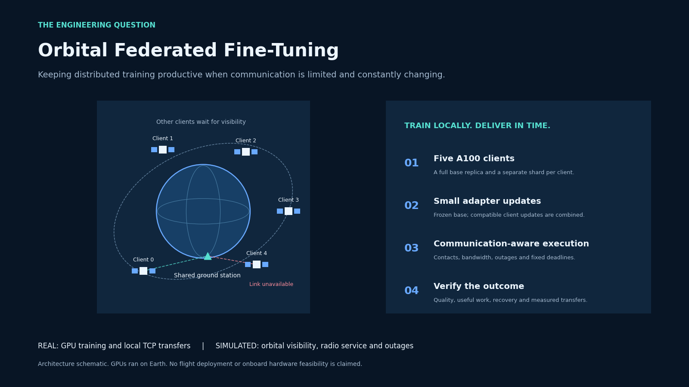
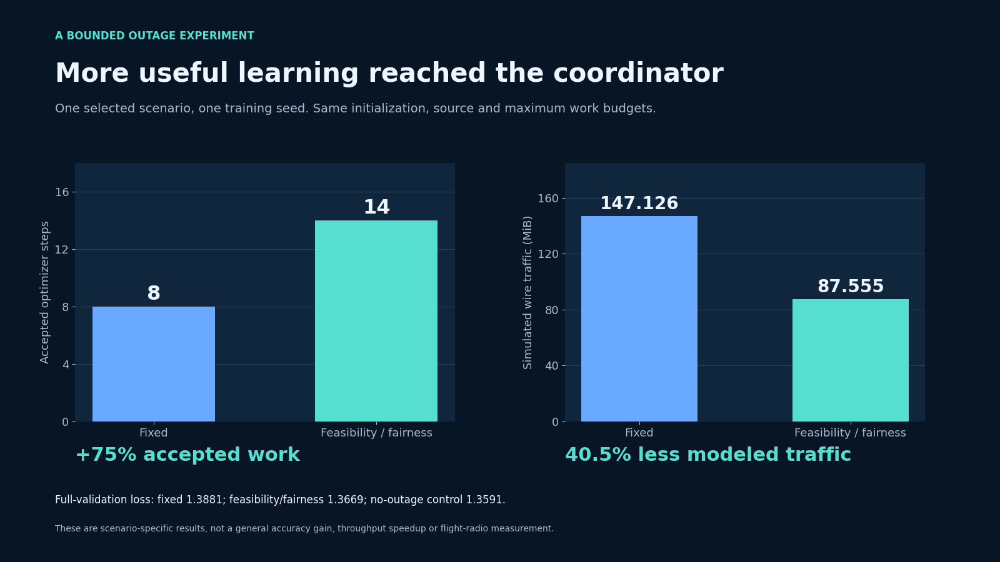
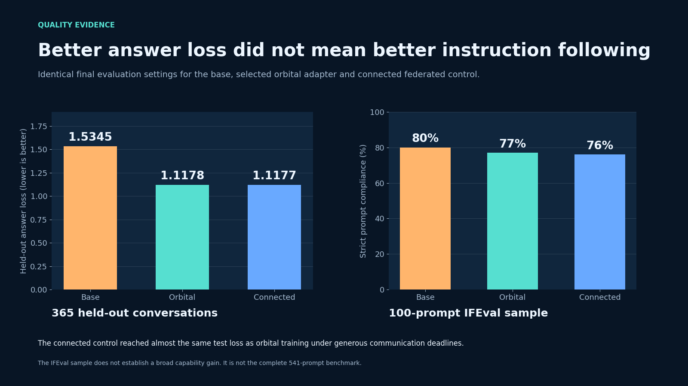
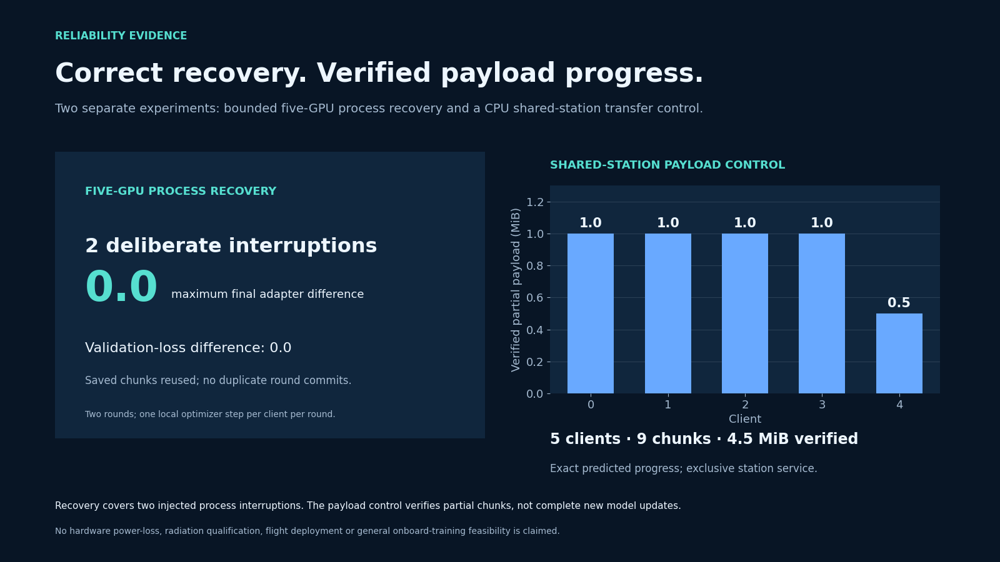

# Orbital Federated Fine-Tuning

This project explores **keeping distributed training productive when communication is limited and constantly changing**. I used the pinned **Qwen/Qwen3.8-27B** base model on **five NVIDIA A100-SXM4-80GB GPUs**, with a complete model replica and a separate data shard on each GPU. Training used a frozen, 4-bit NF4 base with BF16 computation and rank-8 adapters, keeping one adapter factor fixed and training the other so compatible client updates could be averaged into a shared adapter. This kept the trainable and transmitted state small enough for repeatable experiments; five clients also made individual updates easy to trace. The dataset was one reviewed OpenAssistant source from `allenai/tulu-3-sft-mixture`, containing **6,216 training, 344 validation and 365 test conversations**, rather than the entire Tulu mixture. I completed two full training epochs and selected the second-epoch adapter using validation loss. All training ran on Earth. The simulation controlled orbital visibility, bandwidth, shared radio access, upload deadlines and unexpected outages; the experiment does not assume a 27B model can run on an onboard computer.

The main question was how much completed training actually reached the shared model. In one selected outage scenario and training seed, communication-aware scheduling delivered **14 accepted optimizer steps instead of 8**, while simulated wire traffic fell from **147.126 to 87.555 MiB**: **75% more accepted work with 40.5% less modeled traffic**. Validation loss also improved from 1.388090 to 1.366927, although the no-outage control remained better at 1.359109. A separate nine-run comparison across three training seeds showed a less clear-cut tradeoff: the proposed scheduler delivered 18 accepted client updates versus 16 for fixed scheduling, using 5.88% more modeled traffic, while fixed scheduling had slightly better validation loss on every seed. In the full-epoch quality evaluation, validation answer loss was **1.440864 for the base, 1.036431 for the orbital adapter and 1.036380 for the connected federated adapter**; complete-test answer loss was **1.534522, 1.117775 and 1.117747**, respectively, where lower is better. On a fixed 100-prompt IFEval sample, strict prompt accuracy was **80%, 77% and 76%**, and loose prompt accuracy was **84%, 80% and 79%**, in that same order. These results show better fit to the conversation data and nearly identical orbital/connected test loss, without establishing a general instruction-following improvement or a universal scheduling win.

I also tested whether delivery and recovery behave as intended. The CPU outage study covered **648 policy trajectories across six geometries**; these were simulations, with repeated deterministic no-outage cases included. In a bounded GPU recovery experiment, two deliberately interrupted coordinator processes recovered to the exact same final adapter as the uninterrupted control: both the maximum adapter difference and validation-loss difference were **0.0**. Separate local TCP tests replayed saved adapter data under contact schedules; a shared-station control delivered **nine verified chunks totaling 4.5 MiB across all five clients**, with exclusive station use and predicted progress matching stored payloads. Those tests measured partial transfer progress, not new training. For a concrete cost reference, the nine-run scheduling study consumed **12.4333 allocated GPU-hours**, excluding its pilot; that is one study's allocation cost, not the full project cost or measured GPU utilization. The contribution is a reproducible experimental framework for studying useful training work under changing communication constraints, backed by quality comparisons and failure checks. It remains an experimental framework with synthetic communication assumptions, rather than a validated spacecraft system or evidence of feasibility at much larger model scales. The [experiment report](docs/EXPERIMENTS.md), [reproduction guide and pinned revisions](docs/REPRODUCE.md), [project visuals](docs/media/) and [scaling discussion](docs/SCALING.md) provide the supporting evidence and limitations.

